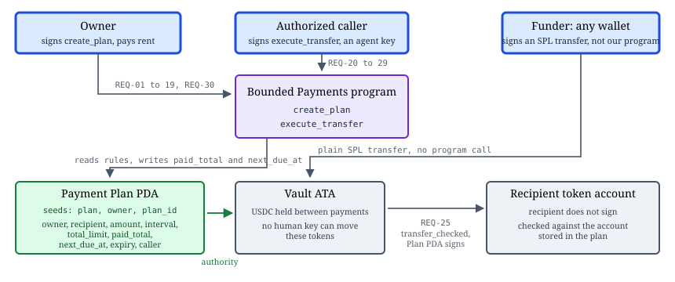

# Bounded Payments

Bounded Payments is a Solana proof of concept for delegated payments.

An owner defines payment rules and funds a vault. The program moves funds only when a payment satisfies those rules.

## Problem

People want software to make routine payments for them. They do not want to give software unrestricted access to their money. Manual approval for every payment removes much of the value of delegation.

## POC

The team will build two use cases in order:

1. **Recurring transfer:** The program pays one fixed recipient when an authorized caller submits a due transfer.
2. **Approved purchase:** An agent selects an item from an owner-approved list. The program pays the approved merchant within the payment limit.

Use case 2 depends on a complete and tested use case 1. The agent, passkey wallet, scheduler, and merchant integration stay outside the on-chain trust boundary.

## Success criteria

- The owner can define a recipient, amount, interval, total limit, and expiry.
- The owner can fund a vault without granting the caller control of the vault.
- An authorized caller can execute a due transfer.
- The program rejects an early, excessive, expired, or unauthorized transfer.
- A failed instruction changes no balance or program state.
- The approved-purchase demo reuses the same bounded payment path.

## Documents

- [Product direction](docs/product-direction.md)
- [Atomic requirements](docs/requirements.md)
- [Architecture](docs/architecture.md)
- [Glossary](GLOSSARY.md)
- [Contribution workflow](CONTRIBUTING.md)
- [Scope decision](docs/adr/0001-stage-the-poc-around-a-recurring-transfer.md)
- [Two handlers, derived limits](docs/adr/0002-two-handlers-derived-limits.md)

## Project status

Stage 1 is implemented and deployed to devnet. The Anchor program has two
handlers, `create_plan` and `execute_transfer`, and a passing local test suite
for REQ-01 to REQ-30. The devnet deployment is verified on-chain; the devnet
test rerun and its screenshot are the captain's live run, not yet captured.

## Architecture

Stage 1 uses one program PDA, three token accounts, and two handlers. The
owner signs `create_plan` and stores the payment rules once. The authorized
caller signs `execute_transfer`. Any wallet funds the vault with a plain SPL
Token transfer, which grants no authority.



The overview is the canonical summary. Diagrams D1 to D4 (overview,
`create_plan` flow, `execute_transfer` flow, end-to-end view), the on-chain
requirements matrix, and full REQ traceability are in
[docs/architecture.md](docs/architecture.md).

## Devnet deployment

- Program ID (pinned): `Hcgo55q8sQZW1cw6UBBErqZEhCYGjph7PKmK26rvkp2Z`
- Mint (pinned): devnet USDC `4zMMC9srt5Ri5X14GAgXhaHii3GnPAEERYPJgZJDncDU`,
  classic SPL Token Program, 6 decimals
- The program is deployed and executable on devnet, owned by the upgradeable
  BPF loader. Verify read-only at any time:

```bash
solana program show Hcgo55q8sQZW1cw6UBBErqZEhCYGjph7PKmK26rvkp2Z --url devnet
```

## Devnet test procedure

The devnet suite exercises the deployed program with live transactions.
Run it from the repository root.

Prerequisites:

- Node.js and npm (dependencies: `npm ci`)
- Solana CLI and `anchor` 0.31.1
- A devnet wallet at `~/.config/solana/id.json`, funded with devnet SOL
- Devnet USDC in that wallet (Circle faucet: https://faucet.circle.com)

Steps:

```bash
npm ci
anchor build
```

Then run the suite against devnet:

```bash
export ANCHOR_PROVIDER_URL=https://api.devnet.solana.com
export ANCHOR_WALLET=~/.config/solana/id.json
npm run test:devnet
```

Expected success markers:

- `anchor build` finishes without errors and writes `target/idl/`.
- Mocha reports `6 passing` and `0 failing`.
- Three transaction signatures are logged: `create_plan signature:`,
  `vault funding signature:`, and `execute_transfer signature:`.
- Each test names its REQ ids, for example REQ-01 to REQ-12 and REQ-25 to REQ-27.

The suite creates real plans on devnet, funds a vault with a plain SPL
Token transfer, and executes one due transfer. It rejects early, expired,
excessive, unauthorized, wrong-mint, and duplicate-seed cases.

## Evidence checklist

Capture the captain's live devnet run:

- [ ] `solana program show` reports the Program ID executable on devnet.
- [ ] `anchor build` succeeds and writes `target/idl/`.
- [ ] `npm run test:devnet` reports `6 passing` and `0 failing`.
- [ ] Three transaction signatures appear in the output.
- [ ] The run screenshot is saved to the path below.

## Devnet test evidence

Reserved for the captain's live run, not yet captured. No test output or
screenshot has been fabricated for this submission.

- Screenshot path: `docs/devnet-test-evidence.png`
- Caption: `npm run test:devnet — 6 passing, 0 failing; create_plan, vault funding, and execute_transfer signatures on devnet`

## FigJam

The team uses the [Bounded Payments FigJam board](https://www.figma.com/board/KwP7iyzbZcchf04sb6pWZx/dapp-diagrams--Copy-) for workshops and diagrams. The repository is the source of truth for approved requirements and decisions.
